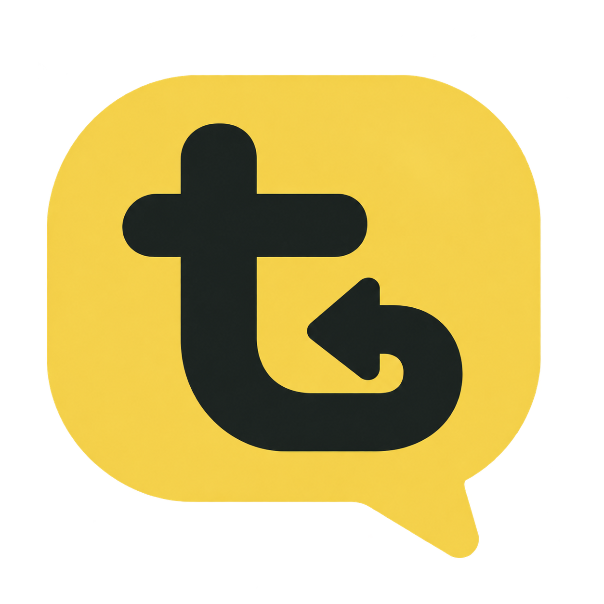

# TalkTurn · 톡턴



**작업 결과는 카톡으로, 답장은 원래 세션으로.**

Windows용 터미널 CLI입니다. Claude Code·Codex·Antigravity CLI(`agy`)의 작업 결과를 카카오톡 **나와의 채팅**에서 보고, 작업 제목 카드에 **답장**해 기존 작업을 이어갑니다.

**0.1.2 알파 · Windows 개발자용.** 카카오 PC 화면과 각 CLI의 수신 연결에 의존합니다. Kakao 공식 제품이 아닙니다.

## 할 수 있는 것

- **결과 받기:** 체크한 작업이 끝나면 결과가 사진(또는 글)으로 카톡에 옵니다.
- **답장으로 이어가기:** 작업 제목 카드나 결과에 답장하면 그 글이 원래 작업에 그대로 전달됩니다. 새 대화를 만들지 않습니다.
- **질문에 답하기:** Claude의 질문·승인 요청이 별도 말풍선으로 오고, 그 말풍선에 답장해 답합니다.
- **폰에서 확인:** PC 화면 스크린샷과 남은 사용 한도를 카톡에서 봅니다.

## 필요한 것

- Windows, Python 3.11 이상, [uv](https://docs.astral.sh/uv/)
- 카카오톡 PC 로그인과 **별도 창으로 연 나와의 채팅**
- 사용하는 CLI(Claude Code·Codex·AGY)의 로그인
- 답장 자동 판별용 Codex 또는 Claude 로그인, Windows PowerShell 5.1과 한국어 OCR 언어 기능

## 설치

uv가 없다면 먼저 설치합니다.

```powershell
powershell -ExecutionPolicy ByPass -c "irm https://astral.sh/uv/install.ps1 | iex"
```

TalkTurn을 설치하고 실행합니다.

```powershell
uv tool install https://github.com/xodn-sell/talkturn/releases/download/v0.1.2/talkturn-0.1.2-py3-none-any.whl
talkturn
```

`talkturn`을 찾지 못하면 `uv tool update-shell`을 실행한 뒤 터미널을 다시 엽니다. 모든 버전은 [Releases](https://github.com/xodn-sell/talkturn/releases)에 있습니다. PyPI에는 아직 올리지 않았으므로 `pip install talkturn`으로는 설치하지 마세요.

## 처음 연결하기

1. PC 카카오톡에서 **나와의 채팅**을 별도 창으로 엽니다.
2. `talkturn`을 실행합니다. **←→**로 Claude Code·Codex·AGY 탭을 바꾸고, **↑↓**로 이동해 **Space**로 받을 작업을 체크한 뒤 **Enter**를 누릅니다.
3. 처음이면 연결할 채팅창과 답장 판별에 쓸 AI를 고르고, 마우스 잠금 안내를 확인합니다.
4. 휴대폰에 온 **[작업 제목]** 카드에 “로그인 실패도 확인해 줘”처럼 답장하면 그 작업에 전달됩니다.

연결 중에는 PC 마우스가 잠깁니다. **Esc를 약 2.5초 누르면** 잠금이 풀리고 연결이 끝납니다. AGY 작업을 받으려면 `talkturn setup-agy`를 한 번 실행합니다.

## 카톡에서 쓰기

| 어디에 답장 | 보낼 말 | 하는 일 |
|---|---|---|
| 작업 제목 카드·결과 | 요청 내용 | 원래 작업에 전달 |
| `talkturn in` 안내 | `help` (대소문자 무관) | 사용법 보기 |
| `talkturn in` 안내 | `화면` · `사용량` | PC 화면 스크린샷 · 남은 한도 |
| `talkturn in` 안내 | `원문` | 받은 결과를 글로 다시 받기 |
| `talkturn in` 안내 | `out` | 연결 끊기 |
| 질문 말풍선 | 번호 · `승인` · `거절` | Claude 질문·승인 요청에 답하기 |

## 업데이트

```powershell
talkturn update          # 버전 목록을 보고 번호로 골라 설치
talkturn update 0.1.0    # 특정 버전 설치(이전 버전으로 되돌리기도 가능)
```

GitHub [Releases](https://github.com/xodn-sell/talkturn/releases)의 버전 중에서 직접 고릅니다. 저절로 업데이트하지는 않습니다. 수신기가 켜져 있으면 잠시 멈췄다가 다시 켭니다. 설치가 끝나면 열려 있는 `talkturn` 창을 닫고 다시 실행하세요.

## 제거

```powershell
talkturn uninstall
uv tool uninstall talkturn
```

TalkTurn이 등록한 훅과 자동 시작만 지웁니다. 개인 상태와 백업은 `%LOCALAPPDATA%\TalkTurn`에 남습니다.

## 더 보기

- [자세한 안내](docs/GUIDE.md): 명령 전체, 문제 해결, AGY 연결, 데이터 처리 범위, 검증 기록
- [릴리스 노트](RELEASE_NOTES.md) · [로드맵](ROADMAP.md) · [기여 안내](CONTRIBUTING.md)

## 라이선스

**AGPL-3.0-only**입니다. 공식 제품으로 오인시키는 이름·로고 사용은 [브랜드 정책](TRADEMARKS.md)에서 다룹니다. 포함된 Kakao Win32 도우미는 [kronenz/kakaotalk-mcp](https://github.com/kronenz/kakaotalk-mcp)의 MIT 코드에서 가져왔으며 [THIRD_PARTY_LICENSES.txt](THIRD_PARTY_LICENSES.txt)에 고지를 보존했습니다.
